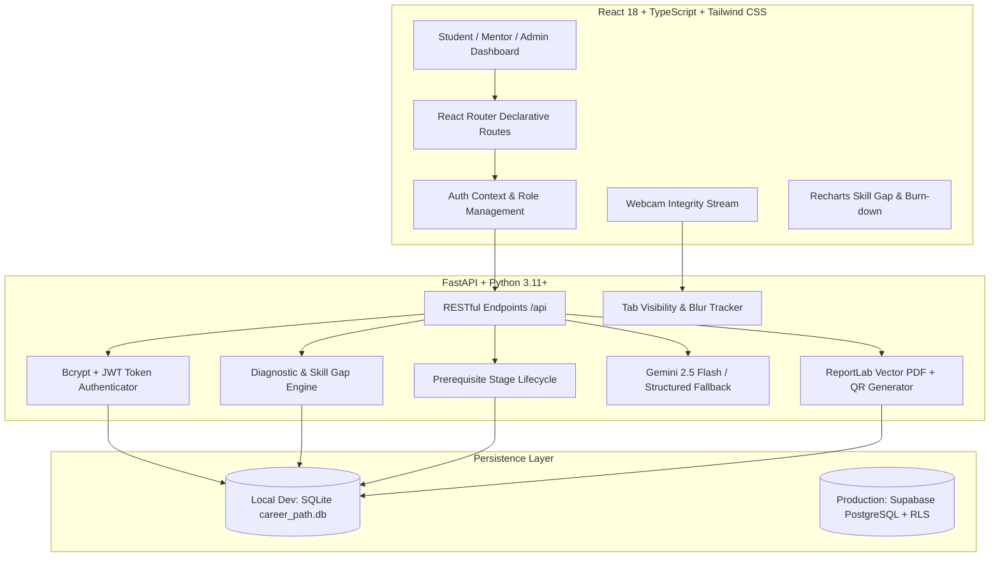

# AI Career & Smart Roadmap System for Students
### Intelligent Career Guidance, Skill Gap Diagnostics, Adaptive Roadmaps, and Verifiable Credentials

[](https://www.python.org/)
[](https://fastapi.tiangolo.com/)
[](https://react.dev/)
[](https://www.typescriptlang.org/)
[](https://tailwindcss.com/)
[](LICENSE)

---

## 🎯 Executive Summary

The **AI Career & Smart Roadmap System** is a complete, production-grade college engineering project developed to solve real challenges faced by students when navigating careers in computing and technology.

Rather than offering generic suggestions or static checklist templates, the system combines:
1. **Explainable AI Career Matching:** Transparent scoring combining student interests, background, and proven technical skills.
2. **Server-Scored Diagnostic Assessments:** Randomized, timed questions with strict answer protection and anti-cheat tracking.
3. **Evidence-Based Skill Gap Analysis:** Explicit formulaic gap calculations ($Gap = Target - Current$).
4. **Dynamic, Prerequisite-Aware Roadmaps:** Intelligent milestone sequencing powered by Google Gemini with deterministic offline fallbacks.
5. **Practical Project Verification:** Real GitHub repository submissions reviewed and graded by mentors and faculty.
6. **Consent-Based Assessment Integrity:** Webcam supervision, tab-switch monitoring, and non-camera alternative modes.
7. **Verifiable Certificates:** ReportLab-generated landscape PDFs with unique cryptographic IDs and public verification QR codes.

---

## 🌟 Problems & Applied Engineering Solutions

| Problem | Applied Solution |
| :--- | :--- |
| **Generic career suggestions** | Transparent weighted career matching combining declared interests, academic profile, and assessment evidence. |
| **Unknown student skill level** | Comprehensive server-scored diagnostic tests with category breakdowns and proficiency scores. |
| **Unstructured self-study** | Sequential, prerequisite-aware stage gates where tasks auto-unlock only upon prerequisite fulfillment. |
| **Unclear skill gaps** | Visual Radar and Bar charts highlighting essential, important, and bonus gaps with targeted resources. |
| **AI prompt copying & cheating** | Server-side answer validation, question shuffling, and consent-based tab switch monitoring. |
| **Fake or unearned certificates** | Strict multi-factor eligibility (80%+ roadmap, 70%+ test, approved project, clean integrity). |
| **Inflexible study schedules** | Dynamic weekly planner allocating study hours according to student commitments and exam schedules. |

---

## 🏛️ System Architecture



---

## 👥 User Roles & Seeded Accounts

The application includes three distinct user roles with full Role-Based Access Control (RBAC):

| Role | Access Permissions | Seeded Demo Credentials |
| :--- | :--- | :--- |
| **Student (Demo: Chaithanya)** | Self-assessment, roadmap generation, study logging, project submission, certificate claiming. | **Email:** `chaithanya@student.college.edu`<br>**Password:** `ChaithanyaPass2026!` |
| **Mentor / Faculty** | Review authorized student portfolios, evaluate capstone projects, provide feedback. | **Email:** `mentor@faculty.college.edu`<br>**Password:** `MentorPass2026!` |
| **Administrator** | Manage careers and skills, review flagged integrity events, view platform metrics. | **Email:** `admin@aicareer.internal`<br>**Password:** `AdminSecurePass2026!` |

> 🔒 **Security Notice:** The first administrator account is created exclusively via the secure bootstrap script (`seed_data.py`). Public registration never grants administrative privileges.

---

## 🚀 Quick Start Guide

### Prerequisites
- **Python 3.10+** (Python 3.11 or 3.12 recommended)
- **Node.js 18+** (Node 20+ recommended)
- **Git**

### 1. Clone the Repository
```bash
git clone https://github.com/your-username/ai-career-smart-roadmap.git
cd ai-career-smart-roadmap
```

### 2. Backend Setup
```bash
# Navigate to backend directory
cd backend

# Create virtual environment
python -m venv venv

# Activate virtual environment
# Windows (PowerShell):
.\venv\Scripts\Activate.ps1
# macOS / Linux:
source venv/bin/activate

# Install dependencies
pip install -r requirements.txt

# Run database migrations and seed default data
python -m app.core.seed_data

# Start FastAPI server
uvicorn app.main:app --reload --port 8000
```
*Backend API documentation will be accessible at: `http://localhost:8000/docs`*

### 3. Frontend Setup
```bash
# Open a new terminal and navigate to frontend
cd frontend

# Install dependencies
npm install

# Start Vite development server
npm run dev
```
*Frontend application will be accessible at: `http://localhost:5173`*

---

## 🧪 Automated Testing

### Backend Unit & Integration Tests (100% Pass)
The backend test suite verifies authentication, career matching, anti-cheat scoring, stage unlocks, weekly planning, project reviews, and certificate issuance:
```bash
cd backend
pytest -v
```
All 12 core test suites pass without external network dependencies:
- `test_root_and_health`: Health check and system readiness.
- `test_student_registration_and_login`: Token issuance and credential verification.
- `test_demo_login_chaithanya`: Pre-seeded demo user verification.
- `test_career_exploration_and_recommendations`: Token similarity and recommendation algorithms.
- `test_diagnostic_assessment_flow_and_anti_cheat_scoring`: Hidden answer validation and server scoring.
- `test_skill_gap_analysis`: Mathematical gap formula verification.
- `test_roadmap_generation_and_task_lifecycle`: Prerequisite chain resolution and stage gates.
- `test_weekly_planner`: Study hour distribution and task scheduling.
- `test_project_submission`: GitHub repository submission.
- `test_certificate_issuance_and_public_verification`: QR code creation and public verification.
- `test_mentor_share_flow`: Revocable mentor access delegation.
- `test_admin_authorization`: RBAC enforcement and metrics aggregation.

### Frontend Compilation & Typecheck
```bash
cd frontend
npm run build
```
Builds cleanly with zero TypeScript errors into the `dist/` production bundle.

---

## 🎓 The "Chaithanya" End-to-End Demo Journey

Follow this step-by-step walkthrough to demonstrate the application to evaluators:

```
[1. Login as Chaithanya]
   Email: chaithanya@student.college.edu | Password: ChaithanyaPass2026!
   Profile: 3rd-year B.Tech CSE | Basic C & HTML | Target: Full-Stack Developer | 14h/week
          |
          v
[2. Career Explorer]
   Navigate to 'Career Explorer' -> Search 'Full-Stack Developer'.
   Notice match score: 76.5% with detailed explainable strengths and missing skills.
          |
          v
[3. Diagnostic Assessment]
   Click 'Assessments' -> Launch 'Full-Stack Diagnostic'.
   Consent to webcam supervision or choose Non-Camera Integrity mode.
   Answer questions (Backend scores answers securely; no answers leaked in DevTools).
          |
          v
[4. Skill Gap Analysis]
   Navigate to 'Skill Gap Analysis'.
   Inspect Interactive Radar & Bar charts.
   Notice critical gaps identified in React, FastAPI, SQL, and Docker.
          |
          v
[5. My Roadmap]
   Navigate to 'My Roadmap' -> Click 'Generate Adaptive Roadmap'.
   Explore Stage 1 (Foundations), Stage 2 (Frontend React), Stage 3 (Backend APIs), Stage 4 (Capstone).
   Mark Stage 1 task 'Complete' -> Watch downstream tasks automatically transition from 'Locked' to 'Available'.
          |
          v
[6. Weekly Study Planner]
   Navigate to 'Weekly Planner'.
   View the 14-hour weekly study schedule allocated across Monday to Sunday.
   Click 'Log Study Hours' to record 2.5 hours completed today.
          |
          v
[7. Practical Capstone Project]
   Navigate to 'Projects'.
   Select 'Full-Stack E-Commerce Platform' -> Click 'Submit Project'.
   Enter GitHub URL and live demo link.
          |
          v
[8. Mentor Review]
   Log out -> Log in as Mentor (`mentor@faculty.college.edu` / `MentorPass2026!`).
   Navigate to 'Mentor Portal' -> Select Chaithanya's project -> Review code and click 'Approve Project'.
          |
          v
[9. Verifiable Certificate & QR Verification]
   Log back in as Chaithanya -> Navigate to 'Certificates'.
   Click 'Claim Certificate' -> Certificate `ACR-2026-FSD-XXXX` is generated.
   Click 'Download Official PDF' to view vector certificate with dynamic QR code.
   Open verification link `/verify-certificate/ACR-2026-FSD-XXXX` in an incognito window to verify public authenticity.
```

---

## 🔒 Security & Privacy Implementation

1. **Answer Masking:** Assessment questions returned to the browser never include correct option IDs or explanation text. Scoring occurs exclusively server-side.
2. **Consent-Based Proctoring:** Camera access requires explicit browser permission. Students can opt for a "Non-Camera Integrity Mode" without penalty.
3. **Tab Switch Monitoring:** Browser tab switches and window blur events are logged as audit events. Excessive switching flags the attempt for admin review.
4. **Least-Privilege RBAC:** Endpoints are guarded by strict role dependencies (`require_role("admin")`, `require_role("mentor")`).
5. **Multi-Tenant Isolation:** Students can only query their own roadmaps, attempts, and notes unless explicitly shared with a mentor via a revocable token.
6. **Supabase PostgreSQL RLS Policies:** Complete production-grade Row Level Security migration scripts provided in `supabase/migrations/`.

---

## 📁 Project Directory Structure

```
AI_CareerPath/
├── .env.example                     # Environment configuration reference
├── README.md                        # Master documentation and guide
├── docs/
│   ├── ARCHITECTURE.md              # Deep system design and algorithmic specifications
│   └── API.md                       # Comprehensive REST API reference
├── backend/
│   ├── requirements.txt             # Python dependencies
│   ├── pytest.ini                   # Pytest test discovery configuration
│   ├── career_path.db               # SQLite database file
│   └── app/
│       ├── main.py                  # FastAPI application entrypoint and middleware
│       ├── core/
│       │   ├── config.py            # Pydantic environment settings
│       │   ├── database.py          # SQLAlchemy session and engine management
│       │   ├── security.py          # Password hashing, JWT auth, and RBAC guards
│       │   └── seed_data.py         # Seed dataset (12 careers, questions, demo accounts)
│       ├── models/
│       │   └── models.py            # 19 normalized relational database entities
│       ├── schemas/
│       │   └── schemas.py           # Pydantic request/response schemas with validators
│       ├── services/
│       │   ├── scoring_service.py   # Diagnostic evaluation and skill gap calculations
│       │   ├── roadmap_engine.py    # Prerequisite DAG resolver and stage gating
│       │   ├── ai_service.py        # Gemini 2.5 Flash LLM + structured rule fallback
│       │   ├── integrity_service.py # Tab switch and window blur tracking
│       │   └── certificate_service.py # ReportLab PDF generation and QR code embedding
│       ├── api/
│       │   └── endpoints/           # Modular route controllers
│       │       ├── auth.py
│       │       ├── careers.py
│       │       ├── assessments.py
│       │       ├── skills.py
│       │       ├── roadmaps.py
│       │       ├── planner.py
│       │       ├── projects.py
│       │       ├── resources.py
│       │       ├── integrity.py
│       │       ├── certificates.py
│       │       ├── mentors.py
│       │       └── admin.py
│       └── tests/
│           └── test_api.py          # Comprehensive 12-suite automated test harness
├── frontend/
│   ├── package.json                 # Node dependencies and build scripts
│   ├── tsconfig.json                # TypeScript strict configuration
│   ├── vite.config.ts               # Vite configuration with /api reverse proxy
│   ├── tailwind.config.js           # Custom Tailwind design tokens
│   ├── index.html                   # Single page application entrypoint
│   └── src/
│       ├── main.tsx                 # React DOM bootstrapping
│       ├── App.tsx                  # Declarative client routes and protected route wrapper
│       ├── index.css                # Base Tailwind styles and animations
│       ├── types/
│       │   └── index.ts             # Complete TypeScript interface declarations
│       ├── services/
│       │   └── api.ts               # Typed Fetch API client
│       ├── context/
│       │   └── AuthContext.tsx      # User authentication and role provider
│       ├── layouts/
│       │   └── DashboardLayout.tsx  # Responsive sidebar, navigation, and top header
│       └── pages/                   # All 15 functional application views
│           ├── LandingPage.tsx
│           ├── OverviewPage.tsx
│           ├── CareerExplorerPage.tsx
│           ├── AssessmentsPage.tsx
│           ├── SkillGapPage.tsx
│           ├── RoadmapPage.tsx
│           ├── PlannerPage.tsx
│           ├── ProjectsPage.tsx
│           ├── ResourcesPage.tsx
│           ├── CertificatesPage.tsx
│           ├── VerifyCertificatePage.tsx
│           ├── IntegrityPage.tsx
│           ├── ProfilePage.tsx
│           ├── MentorPage.tsx
│           └── AdminPage.tsx
└── supabase/
    ├── migrations/
    │   ├── 20261029000001_initial_schema.sql # Complete PostgreSQL DDL
    │   └── 20261029000002_rls_policies.sql    # Row Level Security policies
    └── seed.sql                     # Production PostgreSQL relational seed data
```

---

## 📜 License & Academic Integrity

This project is released under the **MIT License**. It was developed strictly for academic demonstration, career planning education, and skill gap identification. The career match scores and skill gap estimates provided by the platform are meant for self-evaluation and guidance, and do not constitute a formal guarantee of employment.
