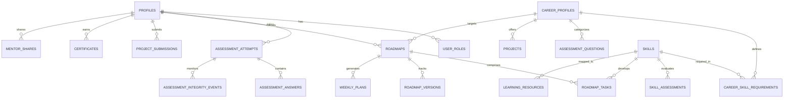

# Architecture and System Design Document
## AI Career & Smart Roadmap System for Students

---

## 1. System Overview

The **AI Career & Smart Roadmap System** is an end-to-end, full-stack educational and career-readiness platform designed to solve student career uncertainty, unmeasured skill gaps, unstructured self-study, and unverified credentials.

### High-Level Architecture

```
+---------------------------------------------------------------------------------------+
|                                    Client Tier                                        |
|   React 18 + TypeScript + Vite + Tailwind CSS + Lucide Icons + Recharts Data Viz       |
|                                                                                       |
|   [Career Explorer]   [Assessments & Integrity]   [Roadmaps & Planner]   [Projects]   |
|   [Skill Gap Radar]   [Certificates & QR Verify]  [Mentor Portal]        [Admin Panel]|
+------------------------------------------+--------------------------------------------+
                                           | HTTPS / JSON REST
                                           v
+---------------------------------------------------------------------------------------+
|                                 Application Server                                    |
|                        FastAPI (Python 3.11+) + Pydantic v2                           |
|                                                                                       |
|  +--------------------+  +--------------------+  +--------------------+  +----------+ |
|  | Auth & Security    |  | Scoring Engine     |  | Roadmap Engine     |  | Integrity| |
|  | JWT / Bcrypt / RBAC|  | Skill Gap Analysis |  | Stage Dependencies |  | Monitor  | |
|  +--------------------+  +--------------------+  +--------------------+  +----------+ |
|  +--------------------+  +--------------------+  +--------------------+  +----------+ |
|  | AI Service Layer   |  | Weekly Planner     |  | Project Submissions|  | PDF Cert | |
|  | Gemini + Fallback  |  | Hour Allocations   |  | Mentor Review      |  | ReportLab| |
|  +--------------------+  +--------------------+  +--------------------+  +----------+ |
+--------------------+---------------------------------------------+--------------------+
                     |                                             |
                     v                                             v
+--------------------+---------------------+   +-------------------+--------------------+
|               Data Persistence                   |             External Services      |
|  SQLAlchemy ORM + SQLite (Local Dev)             |  Google Gemini 2.5 Pro/Flash API   |
|  Supabase PostgreSQL 15+ with RLS (Production)   |  (Structured JSON + Fallback)      |
+--------------------------------------------------+------------------------------------+
```

---

## 2. Component Architecture

### Frontend (Client Layer)
- **Framework:** React 18, Vite bundler, TypeScript strict mode.
- **Styling:** Tailwind CSS with a modern Indigo/Blue/Slate academic color palette.
- **Routing:** React Router v6 with declarative protected routes (`ProtectedRoute` wrapper checking authentication and roles).
- **State Management:** Lightweight React Context (`AuthContext`) handling token persistence in `localStorage`, user role switches, profile updates, and logout.
- **Data Visualizations:** Recharts (`ResponsiveContainer`, `RadarChart`, `BarChart`, `PieChart`) visualizing skill proficiency vs. career targets.
- **Hardware Integration:** Browser `navigator.mediaDevices.getUserMedia()` for consent-based proctoring webcam access with clear visual indicators and fallback non-camera modes.

### Backend (Service Layer)
- **Framework:** FastAPI with asynchronous ASGI execution.
- **Data Validation:** Pydantic v2 schemas validating request payloads and enforcing API response shapes.
- **Authentication:** OAuth2 password bearer flow with HMAC-SHA256 JWT tokens. Password hashing via Passlib with bcrypt.
- **Role-Based Access Control (RBAC):** Three distinct roles: `student`, `mentor`, `admin`. Custom dependency injectors (`require_role("admin")`, `require_role("mentor")`) enforce least-privilege authorization.
- **PDF Generation:** Server-side PDF generation using ReportLab, embedding student name, career track, verification URL, completion metrics, and dynamically rendered QR codes.

### Database (Persistence Layer)
- **ORM:** SQLAlchemy 2.0 with unified entity models.
- **Portability:** Configured out-of-the-box for local SQLite (`career_path.db`) and cloud Supabase PostgreSQL via standard connection string switching.
- **PostgreSQL RLS:** Supabase migration scripts provide Row Level Security policies ensuring students only read/write their own profiles, roadmaps, attempts, and submissions.

---

## 3. Relational Data Models

The database consists of 19 normalized relational tables:



### Table Dictionary

1. `profiles`: User accounts, demographics, education, preferences, target roles, weekly available study hours.
2. `user_roles`: Normalized role assignments (`student`, `mentor`, `admin`).
3. `career_profiles`: 12 industry career paths with metadata, demand level, and entry-level salary ranges.
4. `skills`: Normalized skill registry (technical & soft skills, categories, and default difficulty).
5. `career_skill_requirements`: Join table mapping skills to careers with target proficiency (1-5) and importance (`essential`, `important`, `bonus`).
6. `assessment_questions`: Question repository with options, difficulty levels, skill IDs, and server-side correct option indices.
7. `assessment_attempts`: Test execution records with start/end timestamps, anti-cheat flags, final score, and completion status.
8. `assessment_answers`: Student responses with server-scored correctness and timing.
9. `skill_assessments`: Evaluated proficiency levels (1-5) per skill, derived from assessment outcomes and verified evidence.
10. `roadmaps`: Personalized career plans containing target completion weeks and status.
11. `roadmap_tasks`: Atomic learning tasks with stage index, estimated hours, prerequisite task IDs, and completion status.
12. `roadmap_versions`: Snapshot history for adapted and updated roadmaps.
13. `weekly_plans`: Weekly schedules generated dynamically according to available weekly hours and task priority.
14. `study_logs`: Daily study logs tracking actual hours spent against tasks.
15. `learning_resources`: Curated courses, documentation, articles, and video resources.
16. `projects`: Industry-grade practical capstones with rubrics and skill verification criteria.
17. `project_submissions`: Student GitHub repository links, live demos, and mentor review feedback.
18. `certificates`: Cryptographically verifiable credentials with unique IDs, completion criteria, and PDF storage paths.
19. `mentor_shares`: Explicit, revocable sharing grants from students to mentors/faculty.
20. `audit_logs`: Administrative action logs recording sensitive privilege changes and integrity reviews.

---

## 4. Core Algorithms & Engines

### 4.1 Career Recommendation Engine

The recommendation engine uses an explainable, deterministic hybrid model combining student academic interests, declared skills, and verified assessment scores.

$$\text{Match Score} = w_1 \cdot S_{\text{interests}} + w_2 \cdot S_{\text{skills}} + w_3 \cdot S_{\text{assessment}}$$

Where weights are configurable ($w_1 = 0.35, w_2 = 0.45, w_3 = 0.20$):
- **Interest Similarity:** Normalized token overlap between student interest keywords and career responsibilities/prerequisites.
- **Skill Overlap:** Ratio of required career skills present in student profile, weighted by importance (`essential` = 1.0, `important` = 0.7, `bonus` = 0.4).
- **Assessment Multiplier:** Actual diagnostic score on career-linked technical questions.

### 4.2 Skill Gap Analysis Engine

Given a student's assessed proficiency $P_{\text{current}}(s) \in [0, 5]$ and the career's target requirement $P_{\text{target}}(s) \in [1, 5]$:

$$\text{Gap}(s) = \max\Big(0,\; P_{\text{target}}(s) - P_{\text{current}}(s)\Big)$$

- **Critical Gaps:** $P_{\text{current}}(s) < 2$ and importance is `essential`.
- **Moderate Gaps:** Gap is 1 or 2 levels below target.
- **Proficient:** $P_{\text{current}}(s) \ge P_{\text{target}}(s)$.

### 4.3 Prerequisite-Aware Roadmap Engine

Roadmaps are organized into progressive sequential stages (e.g. Stage 1: Foundations $\to$ Stage 2: Core Development $\to$ Stage 3: Advanced Architectures $\to$ Stage 4: Capstone Projects & Deployment).

#### Task State Machine
- `locked`: Task prerequisites have not yet been marked completed.
- `available`: All prerequisites are completed; student can start.
- `in_progress`: Student is actively studying this task.
- `completed`: Student passed verification / finished task; triggers unlocking cascade.

```
       [Init]
          |
    Prereqs met?
     /        \
  (No)        (Yes)
   v            v
[Locked] -> [Available] -> [In Progress] -> [Completed]
                               ^                  |
                               | (Triggers downstream prereq check)
                               +------------------+
```

### 4.4 Assessment Integrity Monitoring

The assessment engine protects academic honesty while respecting privacy:
1. **Consent-Based Camera Mode:** Requests explicit browser webcam permission. If denied, provides a transparent "Non-Camera Integrity Mode" with zero penalty.
2. **Tab Visibility Tracking:** Listens to `document.visibilitychange` and `window.onblur`. If student leaves tab for $>3$ seconds, logs an event.
3. **Threshold Enforcement:**
   - 1-2 minor tab switches: Marked `clean` or warning advisory.
   - 3+ tab switches or window blur events: Flagged for administrator review (`flagged_review`), preventing automated certificate generation until authorized.
4. **Answer Protection:** Correct options and explanations remain strictly on the backend. Only sanitized questions and randomized choices are served to the frontend.

### 4.5 Verifiable Certificate Engine

Certificates are awarded only when strict, verifiable criteria are satisfied:
1. Student roadmap completion $\ge 80\%$.
2. Diagnostic / Career Assessment score $\ge 70\%$.
3. At least 1 practical project approved with status `approved`.
4. Assessment integrity status is not `flagged_review`.

When claimed:
- Unique identifier format: `ACR-2026-{TRACK_CODE}-{HASH}` (e.g., `ACR-2026-FSD-3B8A1`).
- ReportLab compiles a vector PDF with student name, track, completion metrics, and a dynamic QR code pointing to `https://domain/verify-certificate/{CERT_ID}`.
- Anyone can verify authenticity without requiring an account.

---

## 5. Security & Privacy

1. **Password Security:** Salted bcrypt hashing via `passlib[bcrypt]`.
2. **Stateless Tokens:** JWT tokens signed with HMAC-SHA256 containing expiration timestamps.
3. **Authorization Filters:** Multi-tenant isolation ensuring students can only access their own roadmap, attempts, and notes.
4. **No Frontend Leaks:** Sensitive question answers, database passwords, and AI API keys are restricted to backend execution.
5. **Admin Bootstrapping:** Admins are created exclusively through server CLI/seed scripts (`backend/app/core/seed_data.py`), completely preventing self-registration of administrative privileges.

